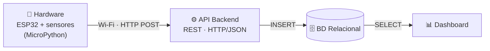

# NEXUS Data — Telemetria IoT com ESP32

Projeto da disciplina **Algoritmo e Estrutura de Dados (BD015)** — CESAR School.

Sistema que coleta dados de sensores em um **ESP32 com MicroPython**, envia as leituras via Wi-Fi para uma **API backend**, armazena em um **banco de dados relacional** e as exibe em um **dashboard**.

## 👥 Equipe

| Nome | Email |
|---|---|
| [Filipe Oliveira] | [fon2@cesar.school] |
| [Paulo Bueno] | [pfdb@cesar.school] |

## 🧱 Arquitetura



Detalhamento dos blocos e do mapeamento de pinos em [`docs/arquitetura.md`](docs/arquitetura.md).

## 📁 Estrutura do repositório

```
├── firmware/            Código do ESP32
│   ├── boot.py          Conexão Wi-Fi (roda a cada boot)
│   ├── main.py          Leitura de sensores e telemetria serial
│   └── config_exemplo.py Modelo de credenciais (copiar para config.py)
├── backend/             API (próximas entregas)
├── database/            Scripts SQL (próximas entregas)
├── dashboard/           Visualização (próximas entregas)
└── docs/                Documentação e diagramas
```

## 🚀 Como executar o firmware

### 1. Driver USB
Instale o driver **CP210x** da [Silicon Labs](https://www.silabs.com/software-and-tools/usb-to-uart-bridge-vcp-drivers?tab=downloads) para o Windows reconhecer a porta COM do ESP32. (Placas com chip CH340 usam outro driver.)

### 2. Gravar o MicroPython (apenas uma vez)
```bash
pip install esptool
esptool --chip esp32 --port COM5 erase_flash
esptool --chip esp32 --port COM5 --baud 115200 write_flash -z --flash_mode dio 0x1000 ESP32_GENERIC-20260824-v1.29.0.bin
```
Substitua `COM5` pela porta da sua placa.

### 3. Configurar as credenciais
Copie `firmware/config_exemplo.py` para `firmware/config.py` e preencha SSID e senha.
> ⚠️ O `config.py` está no `.gitignore` — **nunca** faça commit da senha do Wi-Fi.

### 4. Enviar os arquivos para a placa
- **Thonny:** interpretador *MicroPython (ESP32)* → abra cada arquivo → *Salvar como* → *Dispositivo MicroPython*, com o mesmo nome (`boot.py`, `config.py`, `main.py`).
- **VS Code + MicroPico:** abra a pasta `firmware/`, rode *MicroPico: Connect* e depois *MicroPico: Upload project to board*.

Reinicie a placa (botão EN/RST). O REPL deve mostrar:
```
[boot] Conectando à rede 'MinhaRede'....
[boot] Wi-Fi conectado com sucesso!
[boot]   IP:       192.168.0.42
```

### 5. Sem placa? Use o simulador
No [Wokwi](https://wokwi.com/esp32), crie um projeto **ESP32 + MicroPython** e cole o `boot.py`. Sem `config.py`, ele usa automaticamente a rede `Wokwi-GUEST`.

## ✅ Status das entregas

- [x] Repositório público com README inicial
- [x] Diagrama de arquitetura em blocos
- [x] `boot.py` com conexão Wi-Fi
- [ ] Envio das leituras para a API
- [ ] Modelagem e criação do banco relacional
- [ ] Dashboard

### Evidência da conexão Wi-Fi
<!-- Substitua pelo print do REPL mostrando o IP obtido -->

