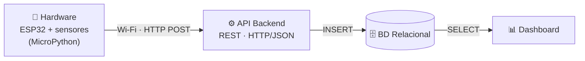
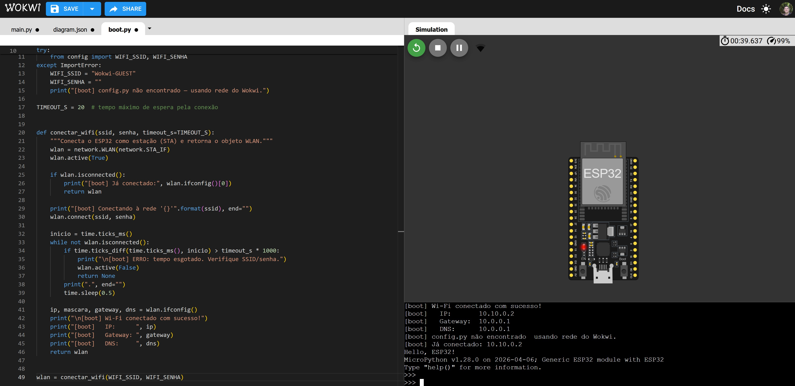

# NEXUS Data — Telemetria IoT com ESP32

Projeto da disciplina **Algoritmo e Estrutura de Dados (BD015)** — CESAR School.

Sistema que coleta dados de sensores em um **ESP32 com MicroPython**, envia as leituras via Wi-Fi para uma **API backend**, armazena em um **banco de dados relacional** e as exibe em um **dashboard**.

## 👥 Equipe

| Nome | Email |
|---|---|
| [Filipe Oliveira] | [fon2@cesar.school] |
| [Paulo Bueno] | [pfdb@cesar.school] |

## 🧱 Arquitetura



Detalhamento dos blocos e do mapeamento de pinos em [`docs/arquitetura.md`](docs/arquitetura.md).

## 📁 Estrutura do repositório

```
├── firmware/               Código do ESP32
│   ├── boot.py             Conexão Wi-Fi (roda a cada boot)
│   ├── main.py             Sensores, atuadores e envio JSON (urequests.post)
│   ├── estruturas.py       Fila de contingência offline + janela de média móvel
│   ├── config_exemplo.py   Modelo de configuração (copiar para config.py)
│   └── wokwi/diagram.json  Circuito para o simulador Wokwi
├── backend/
│   └── servidor_teste.py   Servidor HTTP de teste que recebe os pacotes JSON
├── tests/
│   ├── test_estruturas.py  Testes unitários das estruturas de dados
│   └── simulacao_pc.py     Roda o main.py no PC, de ponta a ponta, sem placa
├── database/               Scripts SQL (próximas entregas)
├── dashboard/              Visualização (próximas entregas)
└── docs/                   Documentação, diagramas e evidências
```

## 🔌 O circuito

| Componente | GPIO | Papel |
|---|---|---|
| Botão (com `PULL_UP`) | 15 | **Sensor digital** — acende o LED digital; segurado por 3 s, simula queda da rede |
| Potenciômetro | 34 (ADC1_CH6) | **Sensor analógico** — 0–4095 (0–3,3 V) |
| LED digital (onboard) | 2 | **Atuador** — segue o botão |
| LED + resistor 220 Ω | 4 (PWM 5 kHz) | **Atuador** — brilho segue a **média móvel** do potenciômetro |

### Foto do circuito montado na bancada


> 📷 **Pendente:** salvar a foto (ou GIF) da montagem como `docs/circuito_bancada.jpg` (ou `.gif`, ajustando o nome acima).

## 🧠 Estruturas de dados em memória (`firmware/estruturas.py`)

As duas estruturas usam um **vetor de tamanho fixo alocado uma única vez** (buffer circular). No ESP32, com pouca RAM, isso evita fragmentação do heap e impede que a memória cresça sem limite. Ambas rodam em **O(1)** por operação.

### 1. Fila de contingência offline — `FilaCircular` (FIFO)

Todo pacote gerado entra no fim da fila; o envio sempre tenta o **primeiro** da fila.

- O pacote só é removido (`desenfileirar`) **depois** que a API responde `2xx`. Se o `POST` falhar, ele fica onde está (`espiar` lê sem remover) e é reenviado no próximo ciclo — nada se perde.
- Sem Wi-Fi, os pacotes se acumulam e, quando a rede volta, são enviados **na ordem em que foram gerados** (até 10 por ciclo, para não travar o loop).
- Capacidade de 50 pacotes (~4 min a 1 pacote / 5 s). Se encher, o **mais antigo é descartado** e contado em `descartados` — o dado mais recente é o mais útil.
- Por que não `list.pop(0)`? Ela é O(n): desloca todos os elementos. Com dois índices andando em círculo (`inicio` e `tamanho`), inserir e remover são O(1).

```
capacidade = 5, inicio = 3, tamanho = 3

índice:   0       1      2      3      4
vetor:  [ seq9 | vazio | vazio | seq7 | seq8 ]
                                  ↑ inicio: próximo a enviar é o seq7
próxima escrita: (inicio + tamanho) % 5 = 1   → a fila "dá a volta" no vetor
```

### 2. Janela deslizante de média móvel — `JanelaMovel`

O ADC do ESP32 é ruidoso. A janela guarda as **10 últimas leituras** do potenciômetro e mantém a **soma corrente**: quando entra um valor novo, subtrai o que sai e soma o que entra. A média sai em O(1), sem percorrer a janela. O LED PWM é controlado por essa média, por isso o brilho não "tremula".

## 📦 Pacote JSON enviado (`urequests.post`)

A cada 5 s o `main.py` monta um pacote e chama `urequests.post(API_URL, json=pacote)`:

```json
{
  "dispositivo": "esp32-nexusdata-01",
  "seq": 18,
  "timestamp": "2026-11-05T21:37:23Z",
  "uptime_ms": 91800,
  "botao_pressionado": false,
  "led_digital": 0,
  "adc": 1663,
  "adc_media_movel": 1629.3,
  "tensao_v": 1.34,
  "tensao_media_v": 1.313,
  "pwm_duty": 407,
  "gerado_offline": false,
  "fila_pendentes": 10
}
```

`seq` é sequencial: o servidor consegue verificar se algum pacote se perdeu. `gerado_offline: true` marca os pacotes que passaram pela fila de contingência. O `timestamp` vem do NTP (fica `null` se o relógio não sincronizar).

## 🚀 Como executar o firmware

### 1. Driver USB
Instale o driver **CP210x** da [Silicon Labs](https://www.silabs.com/software-and-tools/usb-to-uart-bridge-vcp-drivers?tab=downloads) para o Windows reconhecer a porta COM do ESP32. (Placas com chip CH340 usam outro driver.)

### 2. Gravar o MicroPython (apenas uma vez)
```bash
pip install esptool
esptool --chip esp32 --port COM5 erase_flash
esptool --chip esp32 --port COM5 --baud 115200 write_flash -z --flash_mode dio 0x1000 ESP32_GENERIC-20260824-v1.29.0.bin
```
Substitua `COM5` pela porta da sua placa.

### 3. Configurar
Copie `firmware/config_exemplo.py` para `firmware/config.py` e preencha SSID, senha e `API_URL`.
> ⚠️ O `config.py` está no `.gitignore` — **nunca** faça commit da senha do Wi-Fi.

### 4. Subir o servidor de teste (no PC)
```bash
python backend/servidor_teste.py
# Servidor de teste ouvindo em http://192.168.0.15:5000/leituras
```
Use o endereço exibido como `API_URL` no `config.py`. O PC e o ESP32 precisam estar **na mesma rede** (libere a porta 5000 no firewall do Windows, se pedir). Os pacotes recebidos aparecem no terminal e ficam gravados em `backend/leituras_recebidas.jsonl`; também dá para vê-los em `http://localhost:5000/leituras`.

Sem servidor local? Use `API_URL = "http://httpbin.org/post"`: ele responde `200` devolvendo o JSON recebido.

### 5. Enviar os arquivos para a placa
Envie **quatro** arquivos: `boot.py`, `config.py`, `estruturas.py` e `main.py`.
- **Thonny:** interpretador *MicroPython (ESP32)* → abra cada arquivo → *Salvar como* → *Dispositivo MicroPython*, com o mesmo nome.
- **VS Code + MicroPico:** abra a pasta `firmware/`, rode *MicroPico: Connect* e depois *MicroPico: Upload project to board*.

Reinicie a placa (botão EN/RST). O REPL deve mostrar:
```
[boot] Wi-Fi conectado com sucesso!
[boot]   IP:       192.168.0.42
----------------------------------------------------------------------
NEXUS Data — telemetria ESP32 | dispositivo: esp32-nexusdata-01
...
[00017] Botão: OFF   | ADC: 2805 (2.26 V) | Média(10):  2514.5 | PWM: 0628/1023 | Fila: 00 | online
[http] POST seq=1 -> 201 OK | pendentes na fila: 0
```

**Demonstrando a fila offline:** segure o botão por 3 s → `[modo] OFFLINE simulado`. Os pacotes passam a ser guardados (`[fila] Sem rede: pacote seq=… guardado`). Segure de novo por 3 s e veja a fila ser drenada em ordem no terminal do servidor, marcada como `(reenviado da fila offline)`. Desligar o roteador produz o mesmo efeito, com reconexão automática.

### 6. Sem placa? Use o simulador
No [Wokwi](https://wokwi.com/esp32), em um projeto **ESP32 + MicroPython**: cole as listas `parts` (sem a linha do ESP32, que já existe) e `connections` de `firmware/wokwi/diagram.json` no `diagram.json` do projeto, e crie os arquivos `boot.py`, `estruturas.py` e `main.py`. Sem `config.py`, o firmware usa a rede `Wokwi-GUEST` e envia para o `httpbin.org`.

### 7. Testes no PC
```bash
python tests/test_estruturas.py   # testes unitários das estruturas
python tests/simulacao_pc.py      # main.py com hardware simulado + servidor real
```
A simulação derruba o Wi-Fi por 40 s, depois usa o modo offline do botão, e confere que o servidor recebeu **todos** os pacotes, sem perda e em ordem FIFO.

## ✅ Status das entregas

- [x] Repositório público com README inicial
- [x] Diagrama de arquitetura em blocos
- [x] `boot.py` com conexão Wi-Fi
- [x] `main.py` lendo sensores (botão, potenciômetro) e acionando atuadores (LED digital, LED PWM)
- [x] Estruturas de dados em memória: fila de contingência offline (FIFO circular) e janela deslizante de média móvel
- [x] Envio de pacotes JSON via `urequests.post()` para servidor de teste
- [ ] Foto/GIF do circuito montado na bancada
- [ ] Modelagem e criação do banco relacional
- [ ] Dashboard

## 📸 Evidências

### Conexão Wi-Fi (Wokwi)
Projeto: https://wokwi.com/projects/479258817358709761



### Envio dos pacotes JSON
<!-- Salve aqui o print do REPL do ESP32 com as linhas "[http] POST seq=... -> 201 OK"
     e/ou o print do terminal do servidor_teste.py recebendo os pacotes. -->


> 📷 **Pendente:** salvar o print como `docs/evidencia_envio.jpg`.
