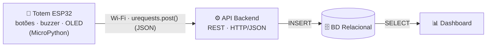
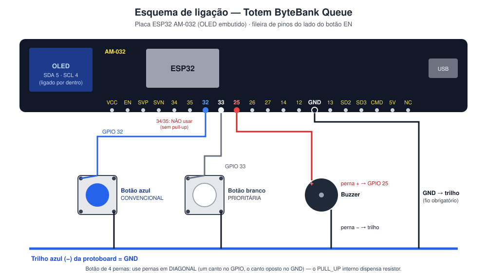
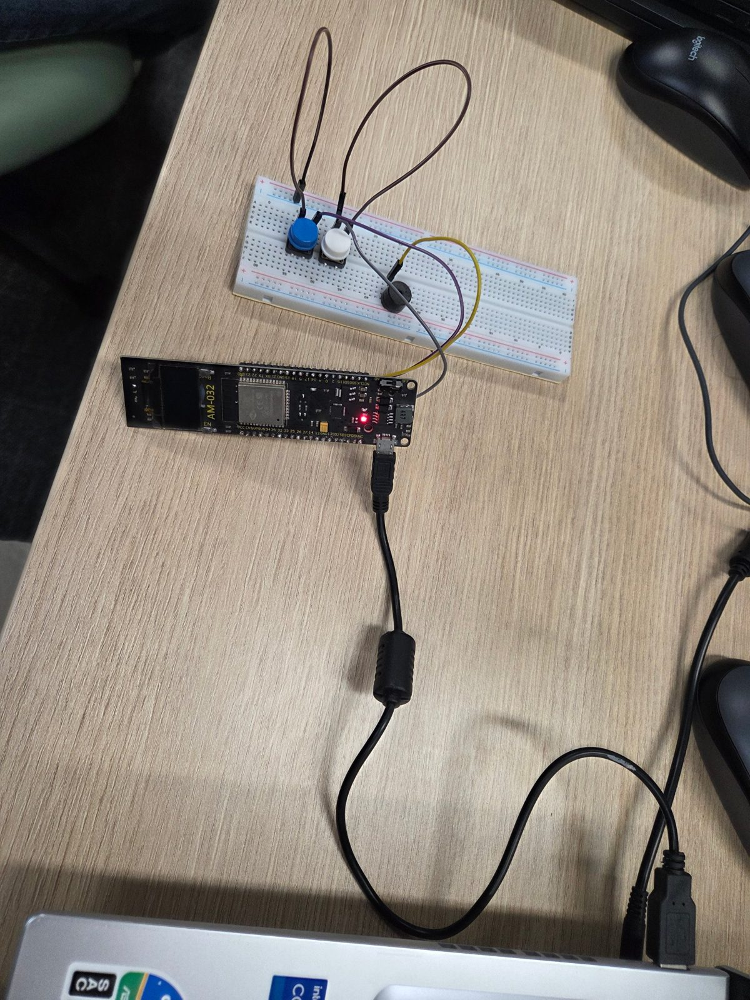
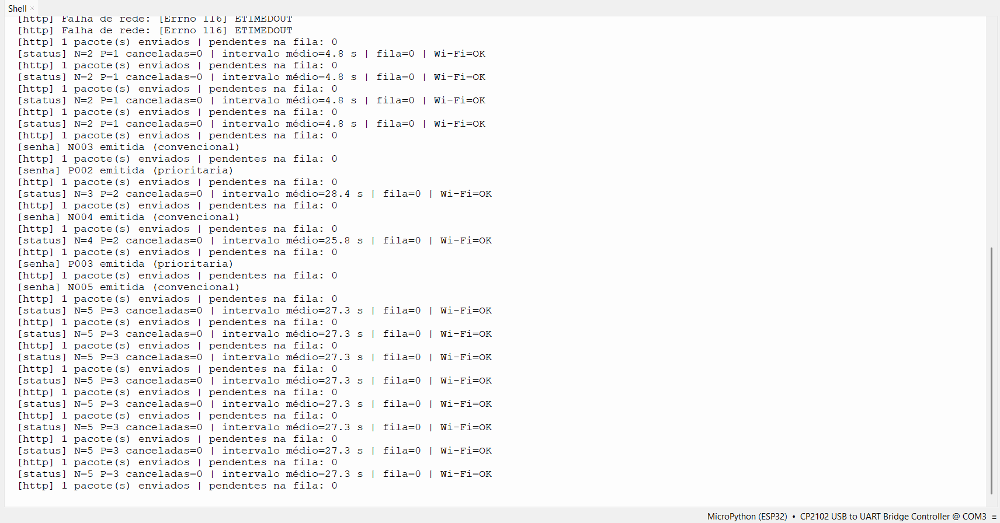
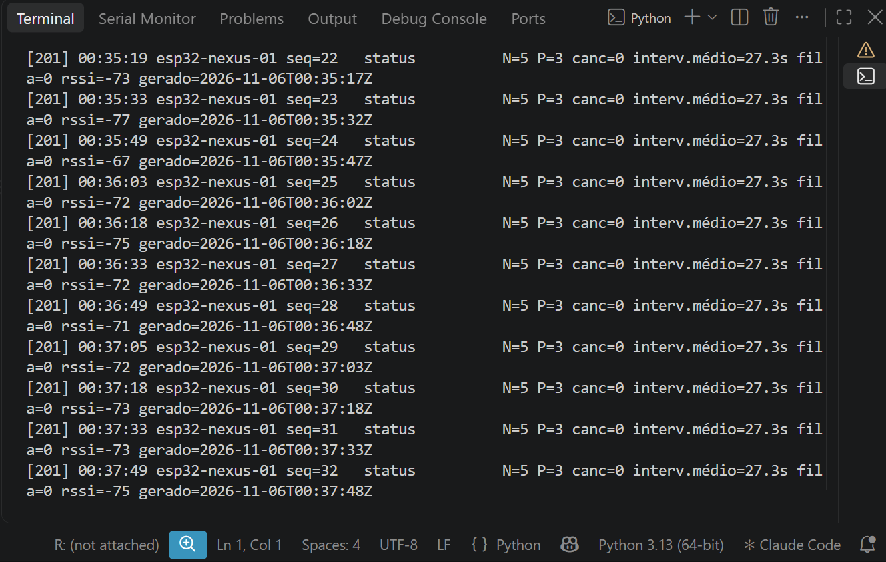

# NEXUS Data — Totem ByteBank Queue (ESP32 + MicroPython)

Projeto da disciplina **Algoritmo e Estrutura de Dados (BD015)** — CESAR School · AV2 — Ecossistema ByteBank IoT.

**Módulo 2 — Totem de Atendimento & Gestão de Filas.** Um ESP32 com MicroPython emite senhas **convencionais** e **prioritárias** por dois botões físicos, confirma com buzzer e display OLED, organiza os dados em **estruturas de dados em memória** e envia cada evento como **JSON via Wi-Fi** (`urequests.post()`) para o backend, que futuramente grava no **banco relacional** exibido no **dashboard**.

## 👥 Equipe

| Nome | Email |
|---|---|
| Filipe Oliveira | fon2@cesar.school |
| Paulo Bueno | pfdb@cesar.school |

## 🧱 Arquitetura



Fluxo interno do firmware, estruturas de dados e formato dos pacotes em [`docs/arquitetura.md`](docs/arquitetura.md).

## 🔌 Esquema de ligação



Placa **ESP32 AM-032** (display OLED 0,96" embutido). Pinos da fileira do lado do botão EN:

| Componente | GPIO | Modo | Papel |
|---|---|---|---|
| Botão azul | 32 | `Pin.IN` + `PULL_UP` (0 = pressionado) | Sensor — emite senha **convencional** (N001…) |
| Botão branco | 33 | `Pin.IN` + `PULL_UP` | Sensor — emite senha **prioritária** (P001…) |
| Buzzer | 25 | PWM 2 kHz | Atuador — bipe de confirmação |
| Display OLED SSD1306 | SDA 5 · SCL 4 (interno) | I2C, endereço 0x3C | Atuador — mostra a senha, histórico e status |
| GND da placa | GND | — | Trilho (−) da protoboard: retorno dos botões e do buzzer |

Os botões usam pernas em diagonal. Os pinos 34/35 não servem para botões porque não têm pull-up interno.

## 🧠 Estruturas de dados no ESP32

Em [`firmware/estruturas.py`](firmware/estruturas.py). Todas usam lista de **tamanho fixo alocada uma única vez** (memória previsível no ESP32) e operações **O(1)**:

| Estrutura | Papel no totem | Operações |
|---|---|---|
| **Fila de contingência offline** (`FilaContingencia`, FIFO, 50) | Todo pacote JSON entra na fila e só sai depois que o servidor responde 2xx. Sem Wi-Fi ou com o servidor fora do ar, os pacotes ficam guardados e são reenviados **na ordem original** quando a conexão volta | `enfileirar` · `espiar` · `desenfileirar` |
| **Pilha LIFO de histórico** (`PilhaHistorico`, 10) | Últimas senhas emitidas; o topo é a senha exibida no display. Segurar um botão 2 s faz `pop()` e **cancela a última senha** | `push` · `pop` · `topo` · `ultimos(k)` |
| **Janela deslizante** (`JanelaDeslizante`, 5) | Média móvel do intervalo entre senhas: o ritmo de chegada de clientes, enviado no pacote de status | `adicionar` · `media` (soma corrente) |

## 📦 Pacotes JSON enviados

`main.py` envia via `urequests.post()` para o `API_URL` configurado. Quatro tipos de pacote, todos com o mesmo cabeçalho:

```json
{
  "dispositivo": "esp32-nexus-01",
  "seq": 12,
  "tipo": "senha_emitida",
  "timestamp": "2026-11-05T23:41:05Z",
  "uptime_ms": 184220,
  "senha": "P004",
  "categoria": "prioritaria"
}
```

| `tipo` | Quando | Campos extras |
|---|---|---|
| `inicio` | ao ligar | `ip` |
| `senha_emitida` | toque rápido num botão | `senha`, `categoria` |
| `senha_cancelada` | segurar um botão 2 s | `senha` |
| `status` | a cada 15 s | `total_convencional`, `total_prioritaria`, `canceladas`, `intervalo_medio_s`, `historico`, `fila_pendentes`, `descartados`, `rssi_dbm`, `mem_livre` |

O `timestamp` é gerado na **coleta**, com o relógio acertado via NTP: um pacote que esperou na fila mantém o horário real do evento. O `seq` permite ao servidor detectar perdas.

## 📁 Estrutura do repositório

```
├── firmware/                 Código do ESP32 (MicroPython)
│   ├── boot.py               Conexão Wi-Fi (roda a cada boot)
│   ├── main.py               Totem: botões, buzzer, OLED, fila e envio HTTP/JSON
│   ├── estruturas.py         FilaContingencia, PilhaHistorico, JanelaDeslizante
│   ├── ssd1306.py            Driver do display OLED (micropython-lib, MIT)
│   ├── teste_hardware.py     Diagnóstico de display, buzzer, botões e envio
│   ├── config_exemplo.py     Modelo de configuração (copiar para config.py)
│   └── wokwi/diagram.json    Circuito para o simulador Wokwi
├── backend/
│   └── servidor_teste.py     Servidor HTTP de teste que recebe os pacotes
├── database/                 Scripts SQL (próximas entregas)
├── dashboard/                Visualização (próximas entregas)
└── docs/
    ├── passo_a_passo.md      Guia completo: da bancada à entrega
    ├── arquitetura.md        Arquitetura, fluxo do firmware e formato dos dados
    ├── guia_imagens.md       Como gerar foto, GIF e prints
    └── img/                  Esquema, fotos e evidências
```

## 🚀 Como executar

> Guia detalhado para quem nunca usou ESP32, com solução de problemas: **[`docs/passo_a_passo.md`](docs/passo_a_passo.md)**.

1. **Driver USB:** instale o driver **CP210x** ([Silicon Labs](https://www.silabs.com/software-and-tools/usb-to-uart-bridge-vcp-drivers?tab=downloads)) ou **CH340**, conforme o chip da placa, e anote a porta COM no Gerenciador de Dispositivos.
2. **MicroPython (apenas uma vez):**
   ```bash
   pip install esptool
   esptool --chip esp32 --port COM5 erase_flash
   esptool --chip esp32 --port COM5 --baud 115200 write_flash -z --flash_mode dio 0x1000 ESP32_GENERIC-20260824-v1.29.0.bin
   ```
3. **Servidor de teste**, no notebook, que precisa estar na mesma rede do ESP32:
   ```bash
   python backend/servidor_teste.py
   ```
   Ele mostra o `API_URL` a usar. Confira com `ipconfig` que é o IPv4 do adaptador **Wi-Fi** e libere o Python no firewall.
4. **Configuração:** copie `firmware/config_exemplo.py` para `firmware/config.py` e preencha `WIFI_SSID`, `WIFI_SENHA` (rede **2,4 GHz**) e `API_URL`.
   > ⚠️ O `config.py` está no `.gitignore`: **nunca** faça commit da senha do Wi-Fi.
5. **Enviar para a placa** `boot.py`, `config.py`, `estruturas.py`, `ssd1306.py` e `main.py`:
   - **Thonny:** *Exibir → Arquivos* → selecione os arquivos → botão direito → *Enviar para /*.
   - **VS Code + MicroPico:** abra a pasta `firmware/` → *MicroPico: Connect* → *MicroPico: Upload project to board*.
6. **Diagnóstico (opcional):** abra `firmware/teste_hardware.py` no Thonny e clique em ▶.
7. **Rodar:** aperte **EN** na placa. Toque no botão azul ou branco para emitir uma senha; segure 2 s para cancelar a última. Cada pacote aparece no servidor como `[201]`.
8. **Testar a fila offline:** pare o servidor (Ctrl+C) e emita algumas senhas. O display mostra `F:1`, `F:2`… Religue o servidor: os pacotes são reenviados em ordem e a fila volta a `F:0`.

**Sem placa?** No [Wokwi](https://wokwi.com/esp32), crie um projeto ESP32 + MicroPython, adicione `boot.py`, `estruturas.py`, `ssd1306.py` e `main.py` e use as peças e ligações de [`firmware/wokwi/diagram.json`](firmware/wokwi/diagram.json). Mantenha a linha da placa do seu projeto, que define a versão do MicroPython. Sem `config.py`, o firmware usa a rede `Wokwi-GUEST` e envia para `http://httpbin.org/post`. Projeto da equipe: https://wokwi.com/projects/479258817358709761

## 📸 Evidências

> Como produzir e publicar estas imagens: [`docs/guia_imagens.md`](docs/guia_imagens.md).

### Circuito montado na bancada


<!-- Ao salvar cada arquivo em docs/img/, apague as linhas de abertura e fechamento de comentário da seção correspondente. -->

<!--
### Totem funcionando

-->

### Envio dos pacotes JSON (REPL do ESP32)


### Pacotes recebidos pelo servidor de teste


### Conexão Wi-Fi (simulador Wokwi)


## ✅ Status das entregas

- [x] Repositório público com README inicial
- [x] Diagrama de arquitetura em blocos
- [x] `boot.py` com conexão Wi-Fi
- [x] `main.py` com leitura dos sensores (botões) e acionamento dos atuadores (buzzer, OLED)
- [x] Estruturas de dados em memória no ESP32: fila de contingência, pilha LIFO e janela deslizante
- [x] Envio de pacotes JSON via `urequests.post()` para servidor de teste
- [x] Foto do circuito montado na bancada
- [ ] API backend com fila de prioridade e gravação no banco
- [ ] Modelagem e criação do banco relacional
- [ ] Dashboard Streamlit
