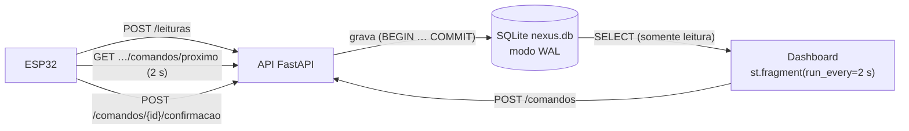

# Dashboard (Streamlit)

Telemetria do totem **em tempo real** e **envio de comandos** para o ESP32.

```bash
pip install -r backend/requirements.txt -r dashboard/requirements.txt
cd backend && python -m api                 # terminal 1: API (cria backend/nexus.db)
streamlit run dashboard/app.py              # terminal 2: abre http://localhost:8501
```

Sem placa por perto? Rode o firmware no computador com o **ESP32 virtual** (terminal 3):
`python -m simulador --auto 4` (um "cliente" aperta um botão a cada ~4 s; teclas `n`, `p`, `c`, `w`, `q`).

## Como os dados chegam



- **Leitura direto do banco** ([`dados.py`](dados.py)): conexão `mode=ro` (o dashboard nunca altera o banco), uma conexão por consulta. Com o modo WAL da API, ler não bloqueia a gravação dos pacotes.
- **Tempo real**: o painel "Ao vivo" é um `st.fragment(run_every=…)`. Só ele é refeito a cada atualização (padrão 2 s, ajustável na barra lateral), sem recarregar a página nem perder o que foi digitado nos controles.
- **Escrita só pela API** ([`api_cliente.py`](api_cliente.py)): o comando vai para `POST /comandos`. A API continua sendo o único escritor do banco e mantém a fila de comandos em memória que o ESP32 consulta.

## O que aparece

| Bloco | Conteúdo | Origem |
|---|---|---|
| Cabeçalho | online/offline (sem contato há mais de 40 s), sessão e `seq`, RSSI, memória livre, fila offline do ESP32 | `dispositivos`, `telemetria_status` |
| Trava e alarme | estado atual; vale o mais recente entre o último `status` e a última confirmação de comando | `transacoes.payload`, `comandos.estado_totem` |
| Fila de atendimento | em espera por categoria, emitidas, canceladas, intervalo médio entre senhas, senhas no display | `vw_saldos`, `telemetria_status` |
| Gráficos | senhas por minuto (30 min); RSSI e fila offline ao longo do tempo | `transacoes`, `telemetria_status` |
| Tabelas | senhas aguardando (prioritárias primeiro), últimos pacotes, comandos e situação, alertas da auditoria | `senhas`, `transacoes`, `vw_comandos`, `logs_auditoria` |

## Comandos

| Botão | No totem |
|---|---|
| 🔒 Travar / 🔓 Liberar trava | Travado, os botões não emitem nem cancelam senhas (bipe grave e "TRAVADO" no display). Aciona o relé/LED do `PINO_TRAVA`, se configurado. O estado fica gravado na flash e sobrevive a um reboot |
| 🚨 Acionar alarme (1–60 s) | Sirene de dois tons no buzzer, sem travar o loop: os botões continuam funcionando |
| 🔕 Silenciar alarme | Interrompe a sirene |
| 🔄 Resetar contador | Zera N/P, histórico e média; a numeração volta a N001/P001 e o servidor abre uma sessão nova. Exige marcar a confirmação |

A **validade** (15 s a 5 min) é o prazo para o totem buscar o comando: se ele estiver desligado, o comando expira e não é executado quando o totem voltar (um alarme pedido há uma hora não deve tocar). A situação de cada comando aparece na tabela e no aviso "Último comando": ⏳ pendente → 📡 entregue → ✅ executado (ou ❌ falhou, ⌛ expirado, ⚠️ sem resposta).

## Configuração

| Variável | Padrão | Uso |
|---|---|---|
| `NEXUS_DB` | `backend/nexus.db` | banco gravado pela API |
| `NEXUS_API` | `http://localhost:5000` | para onde vão os comandos |
| `NEXUS_TZ` | `America/Recife` | fuso das horas exibidas (o banco guarda UTC) |

Banco e API também podem ser trocados na barra lateral.
