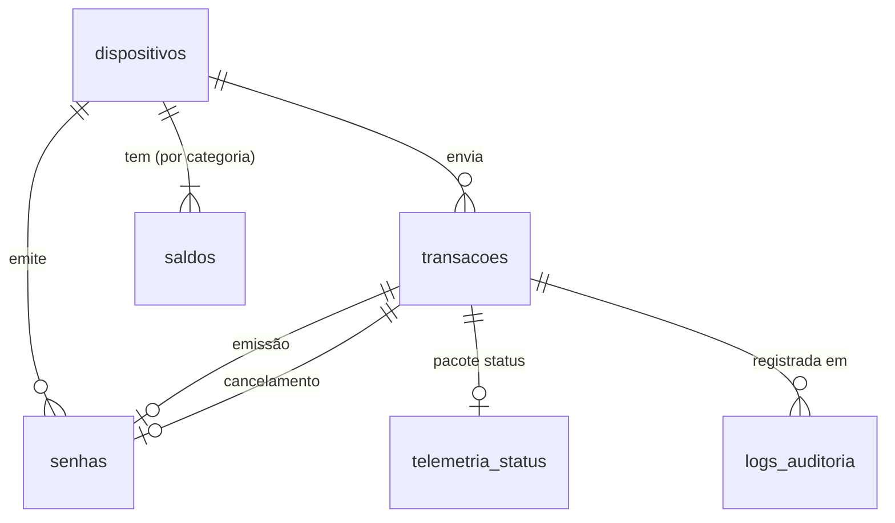

# Database

[`schema.sql`](schema.sql) — modelo relacional (SQLite 3.35+). A API executa o arquivo ao iniciar (todas as instruções usam `IF NOT EXISTS`). Para criar o banco à mão:

```bash
sqlite3 backend/nexus.db < database/schema.sql
```



| Tabela | Conteúdo | Regras no próprio banco |
|---|---|---|
| `dispositivos` | Um totem por `DISPOSITIVO_ID`: IP, boot atual, último `seq` | `identificador` único |
| `transacoes` | **Livro-razão**: cada pacote aceito, com o JSON original em `payload` | `chave_idempotencia` única (reenvio não duplica); tipo e campos de senha coerentes; `payload` JSON válido; **somente-inserção** (triggers bloqueiam `UPDATE`/`DELETE`) |
| `senhas` | Cada senha emitida: `aguardando` → `cancelada`, com as transações de emissão e de cancelamento | Prefixo `N`/`P` coerente com a categoria; cancelada ⇔ tem transação e data de cancelamento |
| `saldos` | Saldo da fila por totem e categoria: `emitidas`, `canceladas`, `em_espera`, `versao` | `em_espera = emitidas − canceladas`, nada negativo, `canceladas ≤ emitidas` |
| `telemetria_status` | Métricas de cada pacote `status` em colunas (totais, intervalo médio, fila, RSSI, memória) | 1:1 com a transação |
| `logs_auditoria` | Toda requisição (aceita, duplicada, rejeitada, falha) e toda anomalia detectada | **Somente-inserção** (triggers) |
| `vw_saldos` (view) | Saldos com o nome do totem, para o dashboard | — |

PostgreSQL: o modelo é o mesmo; as trocas de sintaxe estão no cabeçalho do `schema.sql`.

Consultas úteis:

```sql
-- saldo atual de cada totem
SELECT * FROM vw_saldos;

-- senhas emitidas por hora
SELECT substr(recebido_em, 1, 13) AS hora, categoria, COUNT(*)
FROM transacoes WHERE tipo = 'senha_emitida' GROUP BY 1, 2;

-- anomalias registradas
SELECT ocorrido_em, evento, dispositivo, detalhe
FROM logs_auditoria WHERE nivel <> 'info' ORDER BY id DESC;
```
