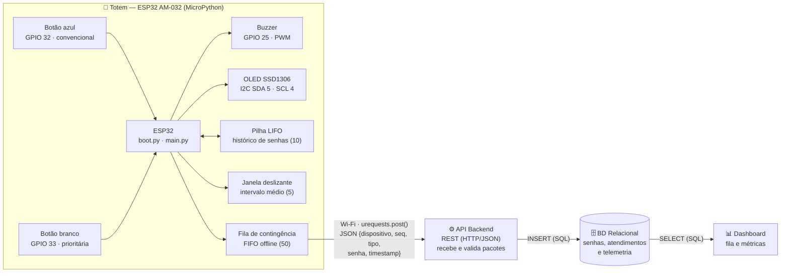
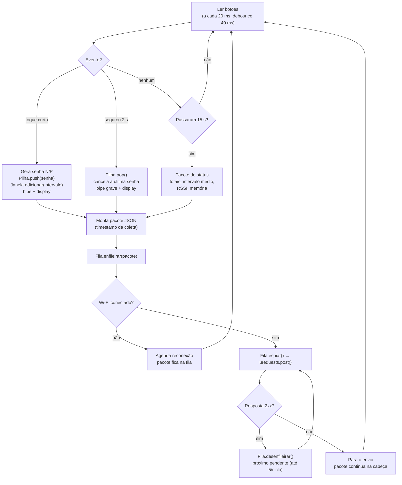

# Arquitetura do Sistema — Totem ByteBank Queue

Diagrama em blocos do fluxo de dados, do botão do totem até a visualização.

## Responsabilidade de cada bloco

| Bloco | Responsabilidade | Tecnologia |
|---|---|---|
| **Totem (hardware)** | Emitir senhas pelos botões, confirmar com buzzer/display, guardar pacotes offline e enviá-los pela rede | ESP32 + MicroPython |
| **API Backend** | Receber e validar os pacotes; ordenar o atendimento (fila de prioridade); gravar no banco | Servidor de teste hoje (`backend/servidor_teste.py`); API definitiva em Flask/FastAPI |
| **BD Relacional** | Registrar senhas, tempos de espera e de atendimento | SQLite ou PostgreSQL (próxima entrega) |
| **Dashboard** | Exibir a fila e as métricas de atendimento | Streamlit (próxima entrega) |

## Mapeamento dos pinos

| Componente | GPIO | Modo | Observação |
|---|---|---|---|
| Botão azul (convencional) | 32 | `Pin.IN` + `PULL_UP` | 0 = pressionado, 1 = solto |
| Botão branco (prioritária) | 33 | `Pin.IN` + `PULL_UP` | idem |
| Buzzer | 25 | PWM 2 kHz, duty 50% | funciona com buzzer ativo ou passivo |
| OLED 128×64 | SDA 5 · SCL 4 | `SoftI2C`, endereço 0x3C | embutido na placa; o firmware testa também 4/5 e 21/22 |
| GND | GND | — | trilho (−) da protoboard |

Os pinos 34, 35, 36 e 39 do ESP32 são só de entrada e não têm pull-up interno, por isso não são usados para os botões. Esquema visual: [`img/esquema_ligacao.svg`](img/esquema_ligacao.svg).

## Fluxo do firmware (`main.py`)

Com pacotes pendentes, o firmware tenta esvaziar a fila de novo a cada 5 s, mesmo sem novos eventos.

## Estruturas de dados em memória (`firmware/estruturas.py`)

| Estrutura | Implementação | Complexidade | Papel |
|---|---|---|---|
| `FilaContingencia` | Buffer circular FIFO de 50 posições | `enfileirar`, `espiar`, `desenfileirar` em O(1) | Tolerância a falhas: pacotes gerados sem rede ficam guardados e são reenviados na ordem original. Fila cheia descarta o mais antigo e contabiliza em `descartados` |
| `PilhaHistorico` | Lista fixa de 10 posições com índice de fundo e tamanho | `push`, `pop`, `topo` em O(1); `ultimos(k)` em O(k) | Histórico das senhas emitidas. O topo é a senha no display; `pop()` cancela a mais recente. Cheia, descarta a mais antiga (o fundo) |
| `JanelaDeslizante` | Buffer circular de 5 posições + soma corrente | `adicionar` e `media` em O(1) | Média móvel do intervalo entre senhas, ou seja, o ritmo de chegada de clientes, enviado no `status` |

**Por que listas de tamanho fixo e não `list.append()` / `list.pop(0)`:**
- A memória é alocada uma única vez, sem fragmentar a pouca RAM do ESP32.
- `pop(0)` custaria O(n), pois desloca todos os elementos; com índices circulares, inserir e remover custa O(1).

O pacote só sai da fila **depois** que o servidor confirma o recebimento (`espiar` → POST → `desenfileirar`). Assim, uma falha no meio do envio não perde o dado.

## Tratamento de falhas

| Situação | Comportamento |
|---|---|
| Trepidação mecânica do botão | Debounce de 40 ms: só aceita mudança estável |
| Botão lendo "pressionado" ao ligar | Aviso no REPL: provável uso de pernas não diagonais |
| Display ou driver `ssd1306.py` ausente | Totem segue funcionando sem tela; aviso no REPL |
| Buzzer com erro no PWM | Totem segue sem som; aviso no REPL |
| Wi-Fi não conecta no boot | `boot.py` lista as redes 2,4 GHz visíveis para ajudar no diagnóstico |
| Wi-Fi cai durante o uso | Pacotes vão para a fila; reconexão a cada 10 s sem travar o loop |
| Servidor fora do ar, timeout (3 s) ou resposta 4xx/5xx | Pacote permanece na fila; nova tentativa a cada 5 s |
| NTP indisponível | `timestamp` = `null`; o backend usa a hora de chegada e o `uptime_ms` |
| `Ctrl+C` | Buzzer desligado, display mostra "Totem parado" e resumo impresso |

## Formato dos pacotes (`POST /leituras`)

Cabeçalho comum a todos os pacotes:

| Campo | Tipo | Descrição |
|---|---|---|
| `dispositivo` | string | Identificador do ESP32 (`DISPOSITIVO_ID` no `config.py`) |
| `seq` | int | Número sequencial do pacote desde o boot |
| `tipo` | string | `inicio`, `senha_emitida`, `senha_cancelada` ou `status` |
| `timestamp` | string \| null | Data/hora UTC da coleta (ISO 8601) |
| `uptime_ms` | int | Milissegundos desde o boot |

Campos por tipo:

| `tipo` | Campo | Tipo | Descrição |
|---|---|---|---|
| `inicio` | `ip` | string | IP obtido pelo ESP32 |
| `senha_emitida` | `senha` | string | `N001`… (convencional) ou `P001`… (prioritária) |
| | `categoria` | string | `convencional` ou `prioritaria` |
| `senha_cancelada` | `senha` | string | Senha removida do topo da pilha |
| `status` | `total_convencional`, `total_prioritaria`, `canceladas` | int | Contadores desde o boot |
| | `intervalo_medio_s` | float \| null | Média móvel do intervalo entre senhas |
| | `historico` | lista | Até 5 senhas do topo da pilha (mais recente primeiro) |
| | `fila_pendentes`, `descartados` | int | Estado da fila de contingência |
| | `rssi_dbm` | int \| null | Intensidade do sinal Wi-Fi |
| | `mem_livre` | int | Bytes livres no heap do MicroPython |
