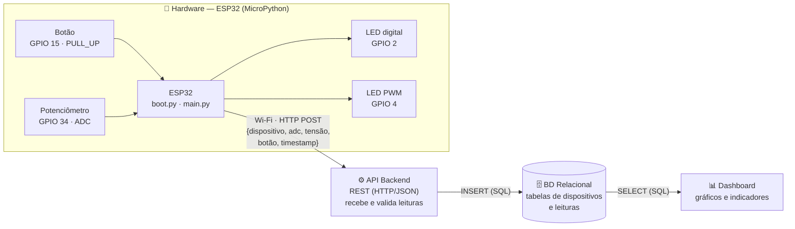

# Arquitetura do Sistema

Diagrama em blocos do fluxo de dados, do sensor até a visualização.

## Responsabilidade de cada bloco

| Bloco | Responsabilidade | Tecnologia (proposta) |
|---|---|---|
| **Hardware** | Ler sensores, acionar atuadores e enviar as leituras pela rede | ESP32 + MicroPython |
| **API Backend** | Receber as leituras, validar e gravar no banco; expor dados para o dashboard | A definir (ex.: Flask / FastAPI) |
| **BD Relacional** | Armazenar dispositivos e histórico de leituras | A definir (ex.: PostgreSQL / MySQL) |
| **Dashboard** | Exibir leituras em tempo quase real e histórico | A definir (ex.: Streamlit / Grafana) |

## Mapeamento dos pinos

| Componente | GPIO | Modo | Faixa |
|---|---|---|---|
| LED digital | 2 (onboard) | `Pin.OUT` | 0 / 1 |
| LED analógico | 4 | PWM 5000 Hz | duty 0–1023 |
| Botão | 15 | `Pin.IN` + `PULL_UP` | 0 = pressionado, 1 = solto |
| Potenciômetro | 34 (ADC1_CH6) | ADC `ATTN_11DB` | 0–4095 (0–3,3 V) |
