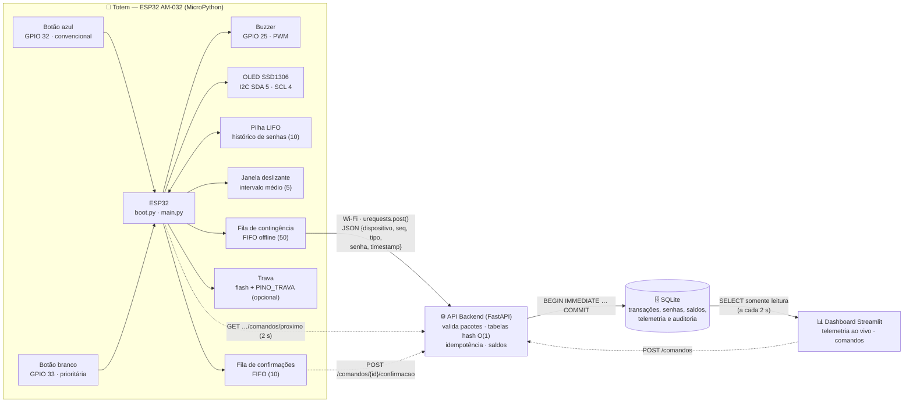
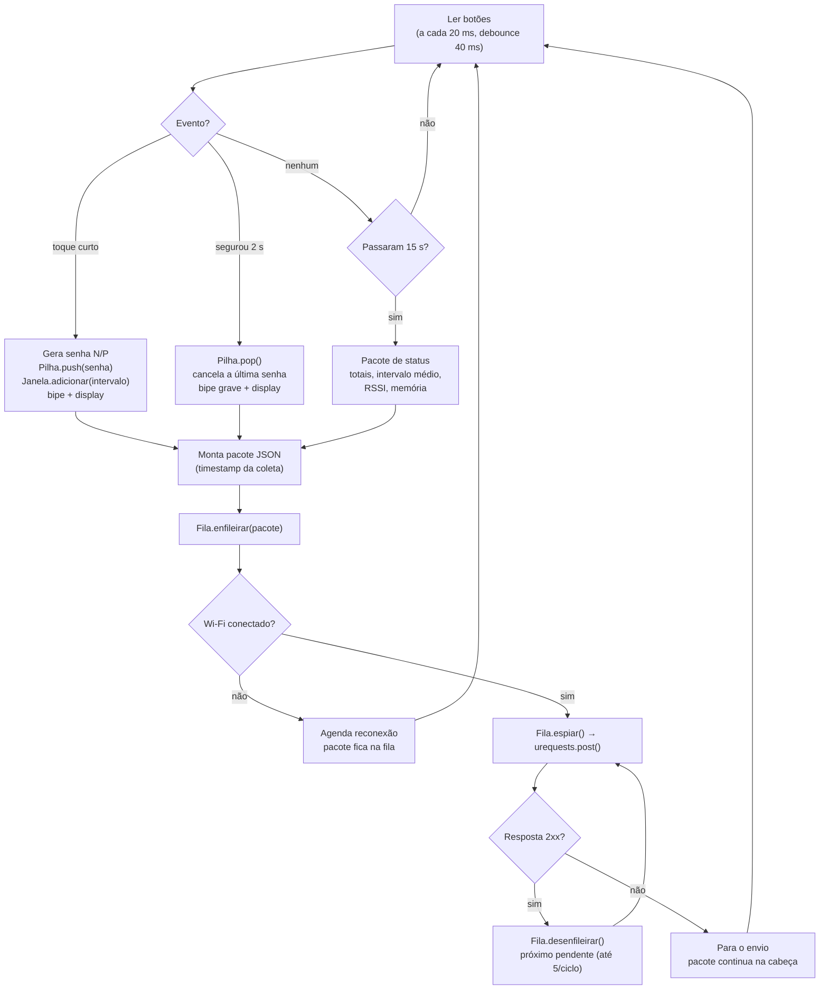
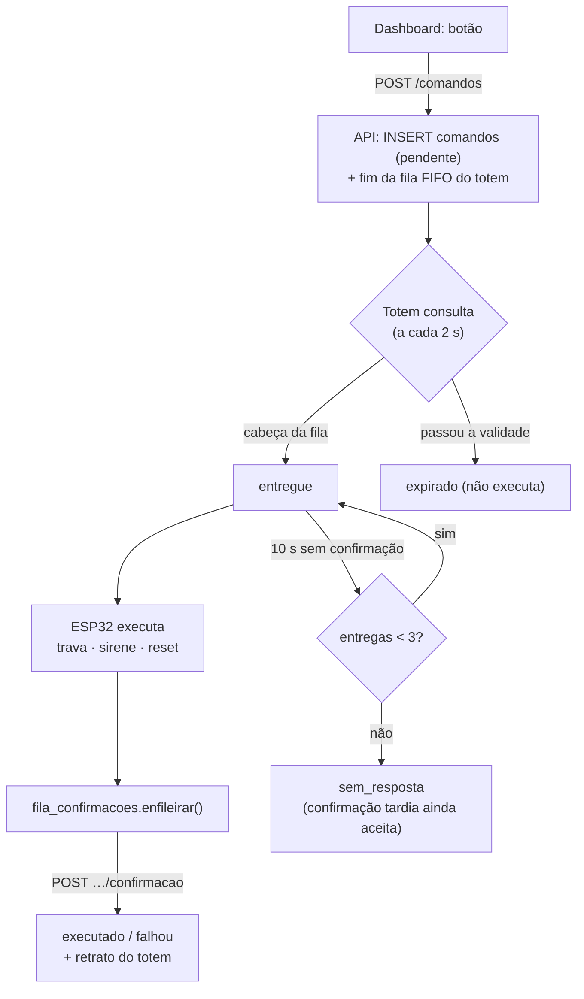

# Arquitetura do Sistema — Totem ByteBank Queue

Diagrama em blocos do fluxo de dados, do botão do totem até a visualização.

## Responsabilidade de cada bloco

| Bloco | Responsabilidade | Tecnologia |
|---|---|---|
| **Totem (hardware)** | Emitir senhas pelos botões, confirmar com buzzer/display, guardar pacotes offline e enviá-los pela rede | ESP32 + MicroPython |
| **API Backend** | Receber e validar os pacotes; detectar reenvios, reboots e perdas; gravar cada pacote numa transação atômica | FastAPI + Pydantic (`backend/api/`); tabela hash própria para os índices em memória |
| **BD Relacional** | Livro-razão de transações, senhas, saldos da fila, telemetria e auditoria | SQLite (`database/schema.sql`), portável para PostgreSQL |
| **Dashboard** | Exibir a telemetria em tempo real e enviar comandos ao totem | Streamlit (`dashboard/`): lê o SQLite direto, escreve só pela API |

## Mapeamento dos pinos

| Componente | GPIO | Modo | Observação |
|---|---|---|---|
| Botão azul (convencional) | 32 | `Pin.IN` + `PULL_UP` | 0 = pressionado, 1 = solto |
| Botão branco (prioritária) | 33 | `Pin.IN` + `PULL_UP` | idem |
| Buzzer | 25 | PWM 2 kHz, duty 50% | funciona com buzzer ativo ou passivo |
| OLED 128×64 | SDA 5 · SCL 4 | `SoftI2C`, endereço 0x3C | embutido na placa; o firmware testa também 4/5 e 21/22 |
| GND | GND | — | trilho (−) da protoboard |

Os pinos 34, 35, 36 e 39 do ESP32 são só de entrada e não têm pull-up interno, por isso não são usados para os botões. Esquema visual: [`img/esquema_ligacao.svg`](img/esquema_ligacao.svg).

## Fluxo do firmware (`main.py`)

Com pacotes pendentes, o firmware tenta esvaziar a fila de novo a cada 5 s, mesmo sem novos eventos. Um evento novo com a fila já ocupada só entra na fila: o envio fica para essa tentativa periódica, para que cada toque não custe um timeout enquanto o servidor está fora do ar.

Além do fluxo acima, cada volta do loop também:

- **atualiza a sirene** do alarme (troca de tom a cada 250 ms, sem `sleep`), se houver um alarme ativo;
- **consulta comandos** a cada 2 s, só com a fila de pacotes vazia: primeiro envia as confirmações pendentes, depois `GET /dispositivos/{id}/comandos/proximo`. Sem resposta, o intervalo dobra até 30 s (recuo exponencial).

## Comandos do dashboard

O ESP32 só faz requisições (não recebe conexões), então os comandos são **buscados** por ele:

| Estrutura | Onde | Papel |
|---|---|---|
| `TabelaHash` identificador → `deque` | API (`idx_comandos`) | Fila FIFO de comandos abertos por totem. A consulta do totem, feita o tempo todo, é O(1) e não toca no banco quando não há comando |
| `FilaContingencia(10)` | ESP32 (`fila_confirmacoes`) | Confirmações que ainda não chegaram ao servidor; reenviadas na ordem |
| `PilhaHistorico(8)` | ESP32 (`executados`) | Últimos comandos executados: um comando reentregue (a confirmação se perdeu) é só confirmado de novo, nunca executado duas vezes |

Por totem, só a cabeça da fila é entregue e o próximo comando só sai depois da confirmação do anterior: `travar` e depois `liberar_trava` sempre nessa ordem. Uma tarefa da API varre os comandos a cada 2 s, então um comando expira mesmo com o totem desligado.

`resetar_contador` zera contadores, pilha, janela **e o `seq`**, e coloca um pacote `inicio` com `motivo: "resetar_contador"` na fila de contingência, **depois** dos pacotes antigos. O servidor recebe tudo na ordem certa e abre uma sessão nova (`boot` + 1, evento `contador_resetado`), em que a conciliação dos totais recomeça do zero.

## Estruturas de dados em memória (`firmware/estruturas.py`)

| Estrutura | Implementação | Complexidade | Papel |
|---|---|---|---|
| `FilaContingencia` | Buffer circular FIFO de 50 posições | `enfileirar`, `espiar`, `desenfileirar` em O(1) | Tolerância a falhas: pacotes gerados sem rede ficam guardados e são reenviados na ordem original. Fila cheia descarta o mais antigo e contabiliza em `descartados` |
| `PilhaHistorico` | Lista fixa de 10 posições com índice de fundo e tamanho | `push`, `pop`, `topo` em O(1); `ultimos(k)` em O(k) | Histórico das senhas emitidas. O topo é a senha no display; `pop()` cancela a mais recente. Cheia, descarta a mais antiga (o fundo) |
| `JanelaDeslizante` | Buffer circular de 5 posições + soma corrente | `adicionar` e `media` em O(1) | Média móvel do intervalo entre senhas, ou seja, o ritmo de chegada de clientes, enviado no `status` |

**Por que listas de tamanho fixo e não `list.append()` / `list.pop(0)`:**
- A memória é alocada uma única vez, sem fragmentar a pouca RAM do ESP32.
- `pop(0)` custaria O(n), pois desloca todos os elementos; com índices circulares, inserir e remover custa O(1).

O pacote só sai da fila **depois** que o servidor confirma o recebimento (`espiar` → POST → `desenfileirar`). Assim, uma falha no meio do envio não perde o dado.

## Tratamento de falhas

| Situação | Comportamento |
|---|---|
| Trepidação mecânica do botão | Debounce de 40 ms: só aceita mudança estável |
| Botão lendo "pressionado" ao ligar | Aviso no REPL: provável uso de pernas não diagonais |
| Display ou driver `ssd1306.py` ausente | Totem segue funcionando sem tela; aviso no REPL |
| Buzzer com erro no PWM | Totem segue sem som; aviso no REPL |
| Wi-Fi não conecta no boot | `boot.py` lista as redes 2,4 GHz visíveis para ajudar no diagnóstico |
| Wi-Fi cai durante o uso | Pacotes vão para a fila; reconexão a cada 10 s sem travar o loop |
| Servidor fora do ar, timeout (3 s), 408, 429 ou 5xx | Pacote permanece na fila; nova tentativa a cada 5 s. Cada volta do loop espera no máximo **um** timeout |
| Servidor recusa o pacote (outro 4xx) | Pacote sai da fila e é contado em `rejeitados`: na cabeça da fila ele bloquearia todos os outros para sempre |
| Toque no botão durante uma requisição HTTP | Uma IRQ na borda de descida marca o toque; se o botão já foi solto quando o loop volta, o toque é contado mesmo assim |
| Comando com o totem desligado | Expira na API depois da validade; não é executado quando o totem volta |
| Reboot com o totem travado | Volta travado (estado em `trava.txt` na flash) |
| Erro ao executar um comando | Confirmado como `falhou` com o motivo; o totem segue rodando |
| NTP indisponível | `timestamp` = `null`; o backend usa a hora de chegada e o `uptime_ms` |
| `Ctrl+C` | Buzzer desligado, display mostra "Totem parado" e resumo impresso |

## Formato dos pacotes (`POST /leituras`)

Cabeçalho comum a todos os pacotes:

| Campo | Tipo | Descrição |
|---|---|---|
| `dispositivo` | string | Identificador do ESP32 (`DISPOSITIVO_ID` no `config.py`) |
| `seq` | int | Número sequencial do pacote desde o boot |
| `tipo` | string | `inicio`, `senha_emitida`, `senha_cancelada` ou `status` |
| `timestamp` | string \| null | Data/hora UTC da coleta (ISO 8601) |
| `uptime_ms` | int | Milissegundos desde o boot |

Campos por tipo:

| `tipo` | Campo | Tipo | Descrição |
|---|---|---|---|
| `inicio` | `ip` | string | IP obtido pelo ESP32 |
| | `motivo` | string | `boot` ou `resetar_contador` |
| | `comando_id` | int | Comando que zerou o contador (só no reset) |
| `senha_emitida` | `senha` | string | `N001`… (convencional) ou `P001`… (prioritária) |
| | `categoria` | string | `convencional` ou `prioritaria` |
| `senha_cancelada` | `senha` | string | Senha removida do topo da pilha |
| `status` | `total_convencional`, `total_prioritaria`, `canceladas` | int | Contadores desde o boot |
| | `intervalo_medio_s` | float \| null | Média móvel do intervalo entre senhas |
| | `historico` | lista | Até 5 senhas do topo da pilha (mais recente primeiro) |
| | `fila_pendentes`, `descartados` | int | Estado da fila de contingência |
| | `rssi_dbm` | int \| null | Intensidade do sinal Wi-Fi |
| | `mem_livre` | int | Bytes livres no heap do MicroPython |
| | `travado`, `alarme` | bool | Estado da trava e da sirene |
