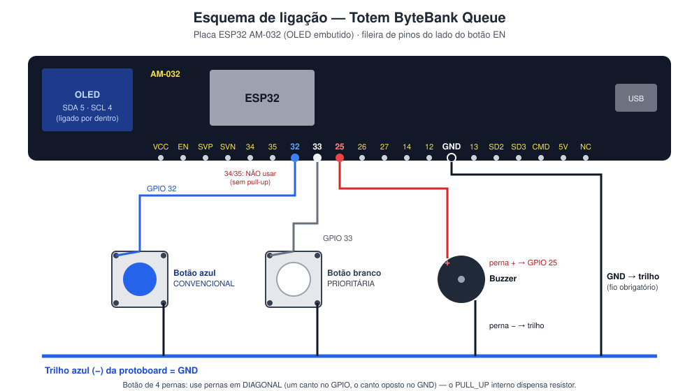

# Passo a passo — da bancada à entrega (para quem nunca mexeu com ESP32)

Este guia segue o **Guia de Configuração do Ambiente MicroPython no ESP32** da
disciplina e leva a equipe do circuito montado até o link entregue no
Classroom. Siga na ordem; cada etapa diz como saber se deu certo.

**O que será entregue:**

| Item pedido | Onde está |
|---|---|
| `main.py` lendo sensores e acionando atuadores | `firmware/main.py` — 2 botões (sensores), buzzer e display OLED (atuadores) |
| Estrutura de dados em memória no ESP32 | `firmware/estruturas.py` — Fila de contingência offline, Pilha LIFO e Janela deslizante |
| Envio de JSON via `urequests.post()` para servidor de teste | `main.py` → `backend/servidor_teste.py` |
| Foto/GIF do circuito no README | `docs/img/` + seção **Evidências** do `README.md` |

---

## Etapa 0 — Material

- [ ] Placa ESP32 **AM-032** (a que tem a telinha OLED na ponta)
- [ ] Protoboard, 2 botões (azul e branco), 1 buzzer, jumpers (fios)
- [ ] **Cabo micro-USB de dados.** Muitos cabos de celular são *só de carga* e o computador não enxerga a placa. Se na Etapa 2 nada aparecer, troque o cabo antes de qualquer outra coisa.
- [ ] Notebook com Windows, **Python 3** (`python --version` no terminal), **VS Code** e/ou **Thonny** ([thonny.org](https://thonny.org)), **Git**
- [ ] Repositório clonado: `git clone https://github.com/RedAkasha/telemetria-esp32-equipenexusdata.git`

---

## Etapa 1 — Conferir e ajustar o circuito

> 🔌 **Faça toda mudança de fio com o cabo USB desconectado.**

### 1.1 Como deve ficar



Os pinos ficam na fileira da placa do lado do botão **EN** (serigrafia: `VCC EN SVP SVN 34 35 32 33 25 26 27 14 12 GND 13 …`).

| Componente | Perna/terminal | Vai para |
|---|---|---|
| Botão **azul** (senha convencional) | um canto | pino **32** da placa |
| | canto **oposto na diagonal** | trilho azul **(−)** da protoboard |
| Botão **branco** (senha prioritária) | um canto | pino **33** |
| | canto oposto na diagonal | trilho azul (−) |
| **Buzzer** | perna **+** (a mais longa ou marcada com +) | pino **25** |
| | perna − | trilho azul (−) |
| **GND** da placa | pino `GND` (entre o `12` e o `13`) | trilho azul (−) |
| Display OLED | — | já vem ligado por dentro da placa (GPIO 5 e 4) |

### 1.2 O que mudar na montagem atual

Comparando com as fotos da bancada:

1. **Tire os fios dos pinos 34 e 35.** Esses pinos só leem sinal e **não têm resistor de pull-up interno**: um botão neles fica "flutuando" (lê pressionado e solto sozinho), e o buzzer não toca porque eles não conseguem enviar sinal. Passe os fios para **32, 33 e 25**.
2. **Ligue um fio do pino `GND` da placa até o trilho azul (−).** Sem ele, os botões e o buzzer não têm "retorno" e nada funciona. Nas fotos esse fio não aparece.
3. **Confira as pernas dos botões.** O botão de 4 pernas tem as pernas ligadas aos pares por dentro. Usando dois cantos **em diagonal** você sempre pega um de cada par: o botão só fecha o contato quando é apertado. Se usar duas pernas do mesmo par, o ESP32 enxerga o botão como "sempre apertado" (o diagnóstico da Etapa 6 avisa).
4. O trilho azul (−) de uma protoboard grande às vezes é **dividido no meio** (a linha azul tem uma falha). Se os componentes estiverem dos dois lados da falha, ligue um jumper entre as duas metades.

---

## Etapa 2 — Conectar a placa e achar a porta COM

1. Ligue a placa no notebook pelo cabo USB. O LED vermelho da placa acende. (A chave **ON** da placa liga a bateria 18650; pelo USB ela funciona com a chave em qualquer posição — se o LED não acender, mude a chave para ON.)
2. Aperte **Win + X → Gerenciador de Dispositivos** → abra **Portas (COM e LPT)**.
3. Deve aparecer algo como **Silicon Labs CP210x USB to UART Bridge (COM5)** ou **USB-SERIAL CH340 (COM6)**. **Anote o número da COM.**
4. Não apareceu nada em *Portas*?
   - Apareceu "Dispositivo desconhecido" com triângulo amarelo → instale o driver: **CP210x** ([Silicon Labs](https://www.silabs.com/software-and-tools/usb-to-uart-bridge-vcp-drivers?tab=downloads)) ou **CH340** ([WCH](https://www.wch-ic.com/downloads/CH341SER_EXE.html)). Desconecte e reconecte a placa.
   - Não apareceu nada em lugar nenhum → é o **cabo** (só de carga) ou a porta USB. Troque o cabo.

---

## Etapa 3 — Verificar se a placa já tem MicroPython

1. Abra o **Thonny** → canto inferior direito → **Configurar interpretador** → *Interpretador*: **MicroPython (ESP32)** → *Porta*: a COM anotada → **OK**.
2. No painel **Shell** (embaixo) deve aparecer algo como:
   ```
   MicroPython v1.2x.x on 20xx-xx-xx; Generic ESP32 module with ESP32
   >>>
   ```
   Apareceu `>>>`? **Pule para a Etapa 4.**
3. Não apareceu (texto estranho, erro ou nada) → grave o MicroPython (uma única vez), como no Guia da disciplina:
   1. Baixe o firmware **ESP32_GENERIC** (arquivo `.bin`) em [micropython.org/download/ESP32_GENERIC](https://micropython.org/download/ESP32_GENERIC/).
   2. **Feche o Thonny** (só um programa pode usar a porta COM por vez).
   3. No terminal, na pasta onde está o `.bin` (troque `COM5` pela sua porta e o nome do arquivo pelo que você baixou):
      ```bash
      pip install esptool
      esptool --chip esp32 --port COM5 erase_flash
      esptool --chip esp32 --port COM5 --baud 115200 write_flash -z --flash_mode dio 0x1000 ESP32_GENERIC-20260824-v1.29.0.bin
      ```
   4. Se aparecer `Failed to connect`: rode o comando de novo e, quando surgir `Connecting....`, **segure o botão Boot** da placa até começar a gravar.
   5. Repita os passos 1–2 desta etapa: agora o `>>>` deve aparecer.

---

## Etapa 4 — Subir o servidor de teste no notebook

1. No VS Code, abra a pasta do repositório e o terminal (**Ctrl + '**). Rode:
   ```bash
   python backend/servidor_teste.py
   ```
2. Ele mostra:
   ```
   No config.py do ESP32 use:  API_URL = "http://172.26.64.215:5000/leituras"
   ```
3. Confira se esse IP é o do **Wi-Fi**: em outro terminal rode `ipconfig | findstr /i "Adaptador IPv4"` e use o IPv4 do bloco **"Adaptador de Rede sem Fio Wi-Fi"** — nunca o do *vEthernet (WSL)*.
4. Se o Windows perguntar sobre o **Firewall**, marque **redes privadas e públicas** e clique em *Permitir*.
5. **Teste rápido com o celular** (conectado na mesma rede Wi-Fi): abra no navegador `http://SEU_IP:5000/`. Se aparecer um texto com `"servidor": "NEXUS Data…"`, o ESP32 também vai conseguir enviar. Se não abrir, veja a Etapa 9 (problemas de rede) antes de continuar.

Deixe esse terminal aberto o tempo todo.

---

## Etapa 5 — Criar o `config.py`

1. Na pasta `firmware/`, copie `config_exemplo.py` e renomeie a cópia para **`config.py`** (ele precisa ficar **dentro de `firmware/`**, junto com o `main.py`).
2. Preencha:
   ```python
   WIFI_SSID = "nome exato da rede"      # maiúsculas/minúsculas contam
   WIFI_SENHA = "senha da rede"
   DISPOSITIVO_ID = "esp32-nexus-01"
   API_URL = "http://SEU_IP_DO_WIFI:5000/leituras"   # o da Etapa 4
   ```
   As linhas de pinos podem ficar como estão se a montagem seguiu a Etapa 1.
3. Salve (**Ctrl + S**).
4. ⚠️ **Se o VS Code perguntar "Atualizar importações?" ao mover/renomear arquivos, clique em _Não_.** Ele troca `from config import` por `from firmware.config import`, que não funciona na placa. Confira: no `boot.py` a linha deve ser `from config import WIFI_SSID, WIFI_SENHA`.
5. O `config.py` aparece em **cinza** no VS Code: é o sinal de que o Git o ignora e a senha não vai para o GitHub. ✔️

**Sobre a rede:** o ESP32 **só conecta em Wi-Fi de 2,4 GHz**. Se a rede tiver o mesmo nome em 2,4 e 5 GHz (comum em faculdades), funciona. Se não, use o hotspot do celular (Etapa 9).

---

## Etapa 6 — Enviar os arquivos para a placa

Arquivos que precisam estar na placa (todos da pasta `firmware/`):

| Arquivo | Para quê |
|---|---|
| `boot.py` | conecta o Wi-Fi ao ligar |
| `config.py` | rede, senha, endereço do servidor |
| `estruturas.py` | Fila, Pilha e Janela deslizante |
| `ssd1306.py` | driver do display OLED |
| `main.py` | o totem |

### Opção A — Thonny (recomendado para a primeira vez)

1. Feche o VS Code **ou** qualquer aba *Serial Monitor/MicroPico* conectada (a porta COM só aceita um programa).
2. Thonny → menu **Exibir → Arquivos**. Aparecem dois painéis: *Este computador* (em cima) e *Dispositivo MicroPython* (embaixo).
3. No painel *Este computador*, navegue até a pasta `firmware` do repositório.
4. Selecione os 5 arquivos da tabela (Ctrl + clique) → botão direito → **Enviar para /** (*Upload to /*). Se perguntar se quer substituir, confirme.
5. No painel do dispositivo devem aparecer os 5 arquivos.

### Opção B — VS Code + MicroPico

1. **Arquivo → Abrir Pasta** e escolha a pasta **`firmware`** (não a raiz do repositório).
2. **Ctrl + Shift + P → MicroPico: Configure Project** (só na primeira vez).
3. Barra azul do rodapé → **Pico Connect** (ou *MicroPico: Connect*).
4. **Ctrl + Shift + P → MicroPico: Upload project to board.**

---

## Etapa 7 — Diagnóstico do hardware (2 minutos que economizam horas)

1. No Thonny, abra `firmware/teste_hardware.py` e clique em **Executar (▶)**. (No MicroPico: *MicroPico: Run current file on Pico*.) Ele roda sem precisar ser salvo na placa.
2. Acompanhe no Shell:

| Teste | Deu certo quando… | Se falhar |
|---|---|---|
| 1. Display | o OLED mostra **TESTE OK** | o script diz quais pinos usar no `config.py` |
| 2. Buzzer | você ouve **3 bipes** | confira perna + no 25 e − no trilho; inverta o buzzer |
| 3. Botões | ao apertar aparece `GPIO 32: PRESSIONADO` (azul) e `GPIO 33` (branco) | veja a mensagem: falta GND, pino 34/35 ou pernas erradas |
| 4. Envio | `Resposta do servidor: 201` e o terminal do servidor mostra `[201]` | Etapa 9 |

---

## Etapa 8 — Rodar o totem

1. Aperte o botão **EN** da placa (reinicia; `boot.py` e `main.py` rodam sozinhos). No Thonny, também dá para clicar no Shell e apertar **Ctrl + D**.
2. O Shell deve mostrar:
   ```
   [boot] Wi-Fi conectado com sucesso!
   [boot]   IP:       172.26.70.9
   [oled] Display encontrado: SDA=5 SCL=4 endereço 0x3c
   NEXUS Data — Totem ByteBank Queue
   ...
   [main] Relógio sincronizado via NTP (UTC).
   [http] 1 pacote(s) enviados | pendentes na fila: 0
   ```
   e a placa dá **dois bipes** de "pronto".
3. Use o totem:

| Ação | O que acontece |
|---|---|
| Toque rápido no **azul** | senha **N001** no display, 1 bipe, pacote `senha_emitida` |
| Toque rápido no **branco** | senha **P001**, 2 bipes agudos |
| **Segurar** qualquer botão por 2 s | bipe curto avisando; ao soltar, a última senha é **cancelada** (pop da pilha) |
| A cada 15 s | pacote `status` com totais, intervalo médio entre senhas, sinal do Wi-Fi e memória livre |

4. No terminal do servidor aparece uma linha `[201]` para cada pacote:
   ```
   [201] 20:41:05 esp32-nexus-01 seq=2    senha_emitida   senha N001 (convencional)   gerado=2026-11-05T23:41:05Z
   ```
   Pronto: **envio bem-sucedido de JSON via `urequests.post()`**. Os pacotes também ficam em `backend/leituras_recebidas.jsonl`.

### 8.1 Demonstrar a fila de contingência offline

1. No terminal do servidor, **Ctrl + C** (servidor desligado).
2. Aperte os botões algumas vezes. O display mostra `F:1`, `F:2`, `F:3`… (pacotes guardados na fila) e o Shell mostra `[http] Falha de rede`.
3. Ligue o servidor de novo (`python backend/servidor_teste.py`). Em até 5 s o ESP32 reenvia tudo **na ordem original**, com o horário em que cada senha foi emitida (`gerado=`), e o display volta para `F:0`.

Esse é o melhor momento para tirar os prints das evidências (Etapa 10).

---

## Etapa 9 — Problemas comuns

| Sintoma | Causa provável | Solução |
|---|---|---|
| `[boot] ERRO: tempo esgotado` e a lista de redes não mostra a sua | rede só 5 GHz | hotspot do celular em **2,4 GHz** (Android: Ponto de acesso → Banda 2,4 GHz; iPhone: *Maximizar compatibilidade*). Conecte o notebook no mesmo hotspot, refaça o `ipconfig` e atualize `WIFI_*` e `API_URL` |
| A rede aparece na lista mas não conecta | senha/nome errados | confira maiúsculas, espaços e acentos no `config.py` |
| `config.py não encontrado — usando rede do Wokwi` | arquivo não enviado ou import trocado | reenvie o `config.py`; confira `from config import` no `boot.py` |
| `[http] Falha de rede: ECONNABORTED / EHOSTUNREACH / ETIMEDOUT` | firewall, IP errado ou rede que isola aparelhos | refaça o teste do celular (Etapa 4.5); libere o Python no firewall (privada **e** pública); redes de faculdade costumam bloquear aparelho-aparelho → use o hotspot. Último recurso: `API_URL = "http://httpbin.org/post"` (servidor público que devolve o JSON) |
| `could not open port COM5` / `Access is denied` | outro programa usando a porta | feche Thonny, VS Code/MicroPico e abas *Serial Monitor* — deixe só um |
| Botão dispara sozinho | pino 34/35 ou sem GND | Etapa 1.2 |
| Display apagado | driver não enviado | envie `ssd1306.py`; rode o diagnóstico |
| O IP do notebook mudou outro dia | DHCP | o servidor mostra o IP novo ao iniciar; atualize o `API_URL` e reenvie o `config.py` |

---

## Etapa 10 — Fotos, GIF e prints

Siga [`docs/guia_imagens.md`](guia_imagens.md). Resumo:

| Arquivo (nome exato) | Como fazer |
|---|---|
| `docs/img/circuito_bancada.jpg` | foto de cima, boa luz, totem ligado com uma senha no display |
| `docs/img/circuito_funcionando.gif` | vídeo de 8–10 s apertando os botões → [ezgif.com/video-to-gif](https://ezgif.com/video-to-gif) |
| `docs/img/evidencia_envio_repl.png` | **Win + Shift + S** no Shell do Thonny com os `[http] … enviados` e a fila esvaziando |
| `docs/img/evidencia_servidor.png` | **Win + Shift + S** no terminal do servidor com as linhas `[201]` |

---

## Etapa 11 — Commits e envio para o GitHub

O histórico de commits vale 25% da nota: faça **vários commits pequenos**, um por assunto, e de preferência com os dois integrantes commitando.

1. Confira o que mudou:
   ```bash
   git status
   ```
   **`firmware/config.py` não pode aparecer na lista.** Se aparecer, pare e verifique o `.gitignore`.
2. Arquivos como `dashboard/README.md` podem aparecer como modificados só por causa de quebra de linha (o VS Code salvou com CRLF). Para descartar essas falsas mudanças:
   ```bash
   git checkout -- dashboard/README.md database/README.md
   ```
3. Commits sugeridos:
   ```bash
   git add .gitignore
   git commit -m "chore: ignora config.py e arquivos gerados"

   git add firmware/estruturas.py
   git commit -m "feat(firmware): fila de contingência, pilha LIFO e janela deslizante"

   git add firmware/main.py firmware/boot.py firmware/config_exemplo.py firmware/ssd1306.py firmware/teste_hardware.py
   git commit -m "feat(firmware): totem com botões, buzzer, OLED e envio JSON via urequests"

   git add backend/
   git commit -m "feat(backend): servidor de teste para receber os pacotes JSON"

   git add docs/arquitetura.md docs/passo_a_passo.md docs/guia_imagens.md docs/img/esquema_ligacao.svg firmware/wokwi/ README.md
   git commit -m "docs: arquitetura, esquema de ligação e passo a passo"

   git add docs/img/
   git commit -m "docs: fotos, GIF e evidências do envio"

   git push
   ```
4. Abra o repositório no GitHub e confira se o README mostra as imagens.

---

## Etapa 12 — Entrega

- [ ] README mostra integrantes, arquitetura, esquema de pinos, instruções e **as 4 imagens**
- [ ] `firmware/` tem `boot.py`, `main.py`, `estruturas.py`, `ssd1306.py`, `config_exemplo.py` (e **não** tem `config.py` no GitHub)
- [ ] `backend/servidor_teste.py` presente
- [ ] `git push` feito e o GitHub mostra os commits
- [ ] Link `https://github.com/RedAkasha/telemetria-esp32-equipenexusdata` enviado na tarefa do **Google Classroom antes do prazo** (atraso = −50% na nota do projeto)
